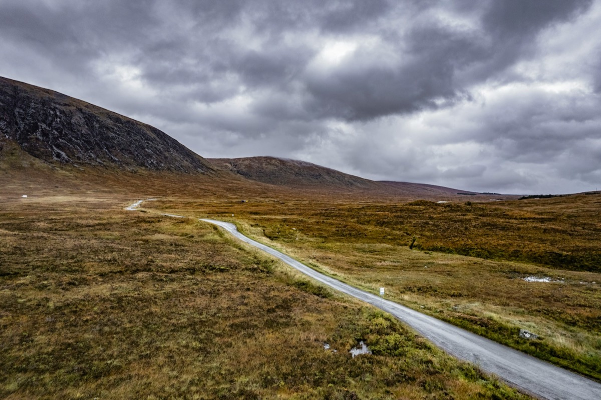
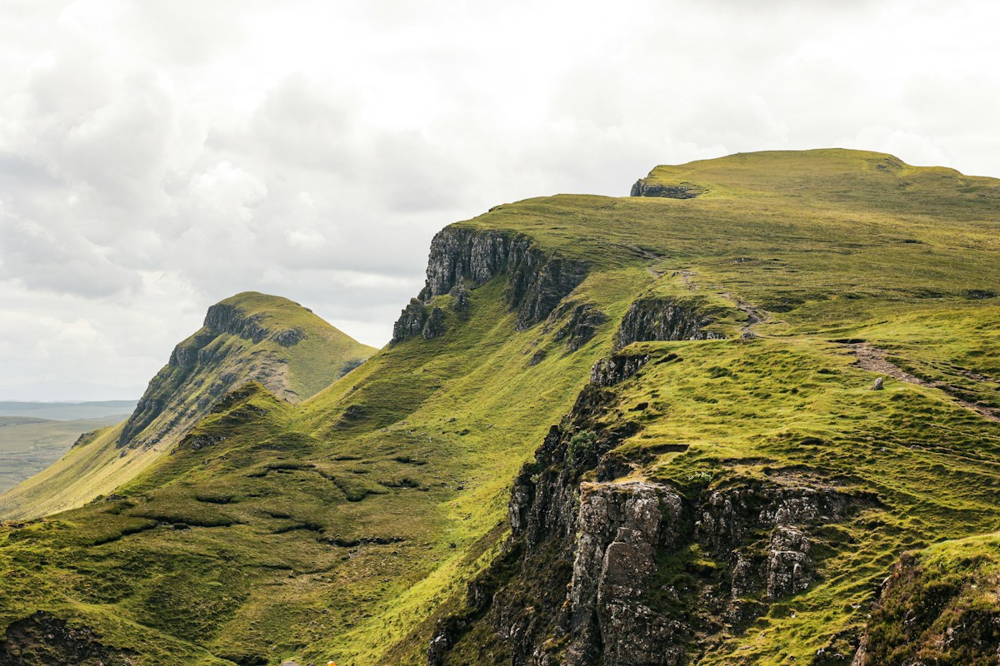
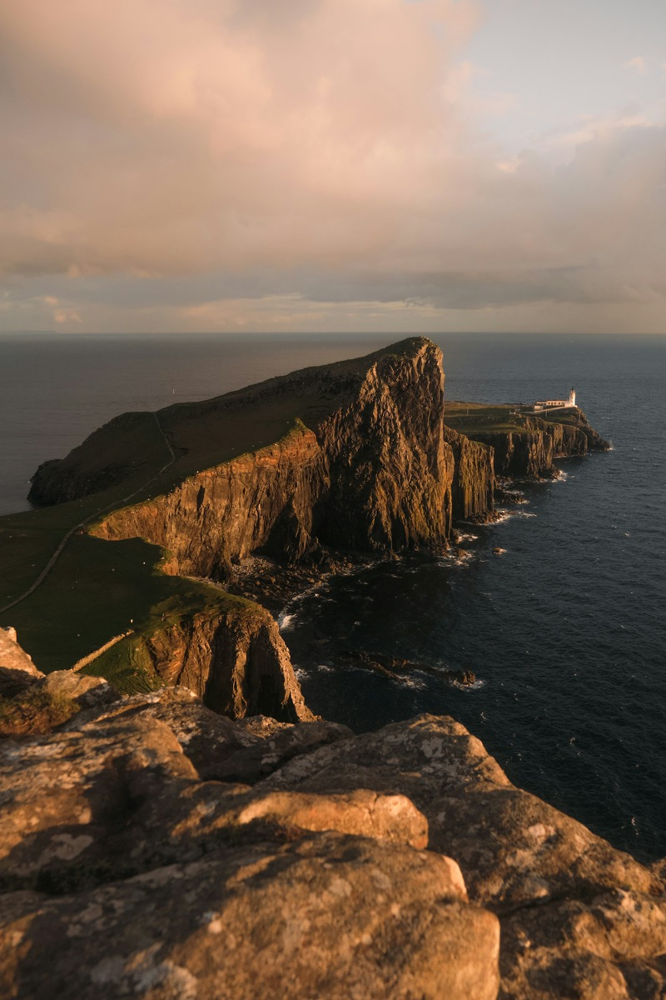
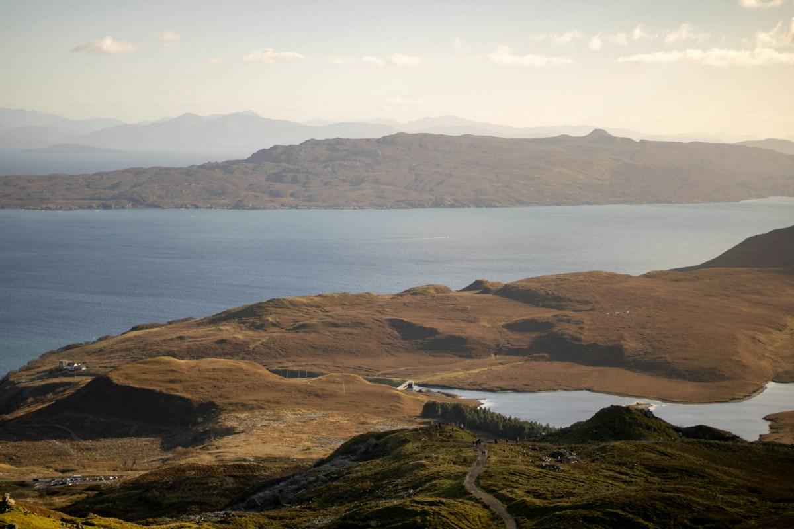

I did not expect to come back with any photographs at all. The forecast
for the week read like a dare — five days of "showers", two of "rain" —
and Skye does not need encouragement to live up to it. But the weather
on the island moves faster than the forecast, and between the fronts the
light arrived in short, unbelievable bursts.

*The week from above: the single-track that set the pace of every day.
Photograph: [Angelo Casto](https://unsplash.com/@jddartphotographer) on
Unsplash.*

## Slow mornings

The rhythm of the week set itself: walk early, hide at lunch, walk
again into the evening. Mornings belonged to the Trotternish
peninsula, where the road threads between grassy slopes and the land
keeps sliding gently towards the sea in the largest landslip in Europe.

*The Quiraing, mid-morning, one brief window between showers.
Photograph: [Joss Broward](https://unsplash.com/@jossbroward) on
Unsplash.*

## One portrait worth keeping

Portraits are the reason I carry the longer lens and the reason it
stays in the bag. The one frame I kept from the whole week is not of a
person at all: the Neist Point lighthouse at the far west of the
island, printed tall, holding the last colour of the day.

*Neist Point at sunset, the lighthouse nearly out of film-noir
central-casting. Photograph:
[Kevin Mueller](https://unsplash.com/@kevinmueller) on Unsplash.*

## What I learned, again

Bring fewer lenses. Bring more socks. The best frame of the day is
almost always the one you nearly did not stop for — in this case a
still stretch of water below the Storr, with the old basalt skyline
holding the last of the light.

*Below the Storr at the end of the day, water like poured glass.
Photograph: [Ash Willson](https://unsplash.com/@ashwillson) on
Unsplash.*

---

*A note on the pictures: the photographs in this post come from
[Unsplash](https://unsplash.com) and are credited to their photographers
in each caption. They are used under the
[Unsplash licence](https://unsplash.com/license) — free to use for
commercial and non-commercial purposes — a different set of terms from
the theme's MIT code licence, and separate from the example site's
generated assets.*
